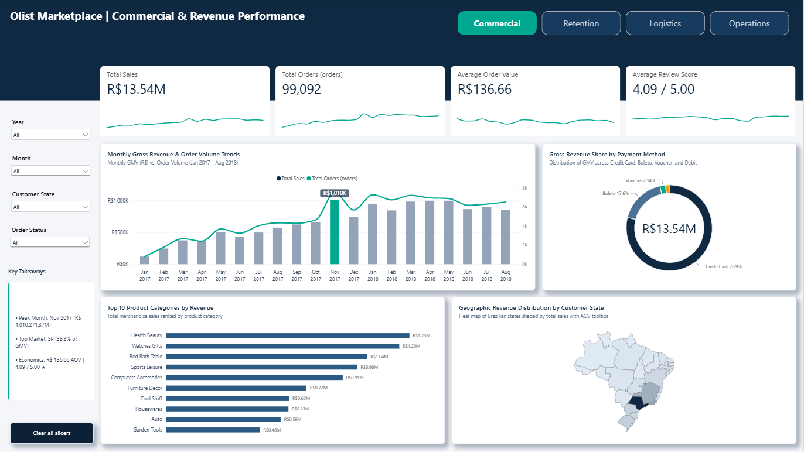
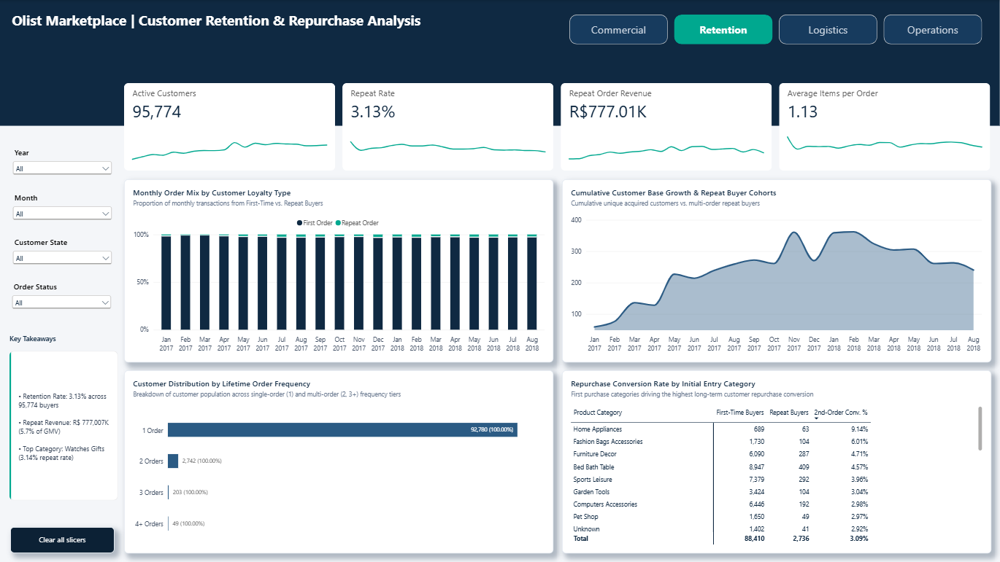
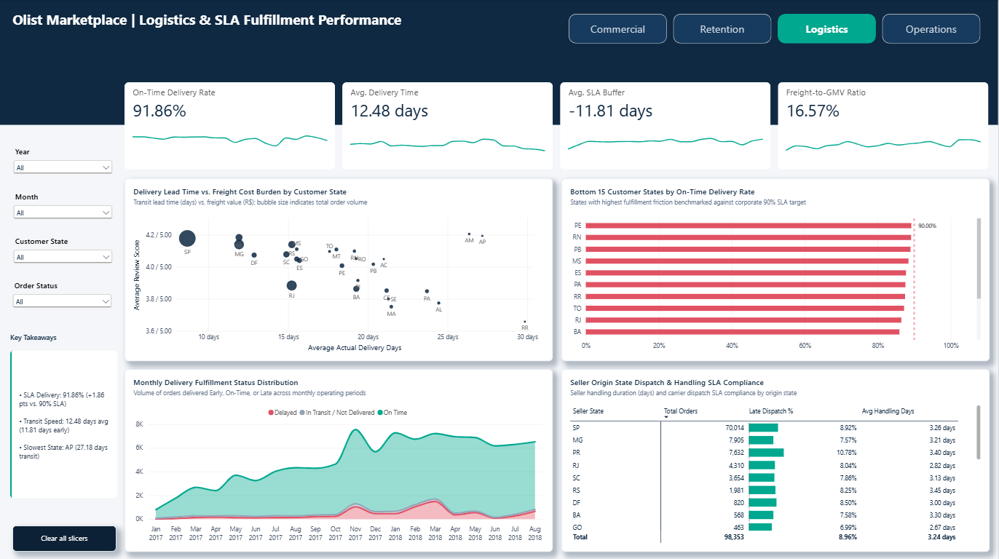
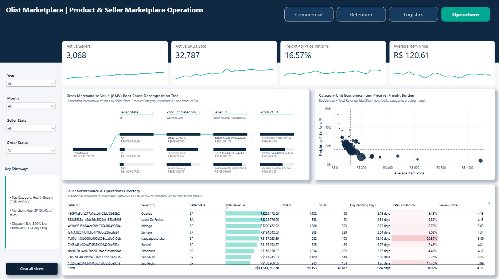

# 🇧🇷 Olist Brazilian E-Commerce Analytics Engineering & Intelligence Suite

[](https://www.snowflake.com/)
[](https://www.getdbt.com/)
[](https://powerbi.microsoft.com/)
[-00A88F?style=for-the-badge&logo=checkmarx&logoColor=white)](https://github.com/microsoft/Analysis-Services)
[](https://opensource.org/licenses/MIT)

An end-to-end, enterprise-grade Analytics Engineering and Business Intelligence solution built on the **Olist Brazilian E-Commerce public dataset**, capturing **20 full operating months** (`January 2017 – August 2018`). 

Engineered with **Snowflake**, **dbt**, and **Microsoft Power BI Developer Mode (`.pbip` / TMDL)**, this repository implements a Kimball star schema, robust data quality test coverage, VertiPaq-optimized tabular modeling, automated executive narrative measures, and a 5-page reporting suite with zero Tabular Best Practice Analyzer (BPA) violations.

---

## 📑 Table of Contents
1. [Executive Overview](#1-executive-overview)
2. [Architecture & Data Lineage](#2-architecture--data-lineage)
3. [dbt Data Modeling & Quality Governance](#3-dbt-data-modeling--quality-governance)
   - [Staging Layer (8 Models)](#staging-layer-8-models)
   - [Dimensional Star Schema (4 Dimensions & 2 Facts)](#dimensional-star-schema-4-dimensions--2-facts)
   - [Analytics Marts (3 Models)](#analytics-marts-3-models)
   - [Quality Governance & Automated Testing](#quality-governance--automated-testing)
4. [Power BI Semantic Model & Best Practice Analyzer (BPA) Compliance](#4-power-bi-semantic-model--best-practice-analyzer-bpa-compliance)
   - [TMDL Model Architecture & Engine Optimization](#tmdl-model-architecture--engine-optimization)
   - [Governed DAX Measures & Dynamic Executive Narratives](#governed-dax-measures--dynamic-executive-narratives)
   - [Tabular Best Practice Analyzer (BPA) Audit Results](#tabular-best-practice-analyzer-bpa-audit-results)
5. [Executive Dashboard Showcase](#5-executive-dashboard-showcase)
   - [Page 1: Commercial & Revenue Performance](#page-1-commercial--revenue-performance)
   - [Page 2: Customer Retention & Repurchase Analysis](#page-2-customer-retention--repurchase-analysis)
   - [Page 3: Logistics & SLA Fulfillment Performance](#page-3-logistics--sla-fulfillment-performance)
   - [Page 4: Product & Seller Marketplace Operations](#page-4-product--seller-marketplace-operations)
   - [Page 5: Order & Seller Transaction Drill-Through](#page-5-order--seller-transaction-drill-through)
6. [Repository Structure & Local Setup](#6-repository-structure--local-setup)
   - [Repository Directory Tree](#repository-directory-tree)
   - [Local Reproduction & Setup Guide](#local-reproduction--setup-guide)

---

## 1. Executive Overview

Olist is the largest department store in Brazilian marketplaces, empowering thousands of small merchants across Brazil to sell products through a single integration hub. Between January 2017 and August 2018, the marketplace processed **99,441 customer orders** totaling **R$ 13.59M in gross merchandise value (GMV)** and **R$ 15.42M in gross transactions** across **32,951 unique SKUs** and **3,095 active sellers**.

Operating an e-commerce marketplace at continental scale across Brazil's 27 federative units presents complex operational challenges:
* **Logistical Disparities:** Fulfillment lead times vary dramatically from 5–8 days within the industrialized Southeast (São Paulo, Rio de Janeiro) to 25–35+ days in the North and Northeast (Acre, Roraima, Amapá), severely impacting customer satisfaction.
* **Customer Acquisition vs. Retention:** 96.9% of acquired buyers place only a single transaction, requiring high customer acquisition costs (CAC) that make identifying repeat conversion pathways critical.
* **Merchant SLA Compliance:** Carrier handover delays and seller dispatch friction create downstream customer delivery delays that degrade platform NPS.
* **Data Ingestion Friction:** Raw data arrives with non-atomic timestamps, uncleaned postal code prefixes with hundreds of duplicated coordinates, unindexed alphanumeric surrogate keys, and Portuguese-only product taxonomies.

This project delivers a resilient analytics foundation that transforms raw transactional extracts into business-ready dimensional marts and an interactive reporting suite for executive leadership, commercial category leads, and logistics directors.

---

## 2. Architecture & Data Lineage

The data pipeline transitions through five architectural tiers, enforcing data contracts, schema testing, and columnar storage optimization at every stage:

```mermaid
flowchart TD
    subgraph S1["Raw Ingestion Tier (Snowflake DW)"]
        R1[("raw_orders")]
        R2[("raw_order_items")]
        R3[("raw_order_payments")]
        R4[("raw_products")]
        R5[("raw_customers")]
        R6[("raw_sellers")]
        R7[("raw_category_translation")]
        R8[("raw_geolocation")]
        R9[("raw_order_reviews")]
    end

    subgraph S2["dbt Staging Views (schema: staging)"]
        STG1["stg_orders"]
        STG2["stg_order_items"]
        STG3["stg_order_payments"]
        STG4["stg_products"]
        STG5["stg_customers"]
        STG6["stg_sellers"]
        STG7["stg_geolocation"]
        STG8["stg_order_reviews"]
    end

    subgraph S3["dbt Dimensional Marts (schema: marts)"]
        direction TB
        subgraph StarSchema["Dimensional Star Schema (Tables)"]
            DIM_DATE["dim_date<br/><i>(Spine: 2016–2020)</i>"]
            DIM_CUST["dim_customers<br/><i>(Unique Customer Grain)</i>"]
            DIM_PROD["dim_products<br/><i>(English Taxonomies & Tiers)</i>"]
            DIM_SELL["dim_sellers<br/><i>(Merchant Geolocation)</i>"]
            DIM_STAT["dim_order_status<br/><i>(Lifecycle Dimension)</i>"]
            FCT_ORD["fct_orders<br/><i>(Order Grain Snapshot)</i>"]
            FCT_ITM["fct_order_items<br/><i>(SKU / Line-Item Grain)</i>"]
        end
        subgraph AnalyticsMarts["Aggregated Analytics Marts"]
            M_SALES["monthly_sales_summary"]
            M_DELIV["delivery_performance"]
            M_REPUR["customer_repurchase_analysis"]
        end
    end

    subgraph S4["Power BI Semantic Model (.pbip / TMDL)"]
        TMDL_MODEL["Olist Marketplace Intelligence Suite<br/><i>• Tabular Model Definition Language (TMDL)<br/>• VertiPaq int64 Date Keys<br/>• 43 Governed DAX Measures<br/>• 0 BPA Violations (100% Pass)</i>"]
    end

    subgraph S5["Executive BI Suite (5 Pages / PBIR)"]
        P1["Page 1: Commercial & Revenue"]
        P2["Page 2: Customer Retention"]
        P3["Page 3: Logistics & SLA"]
        P4["Page 4: Operations & Sellers"]
        P5["Page 5: Order & Seller Drill-Through"]
    end

    %% Lineage connections
    R1 --> STG1
    R2 --> STG2
    R3 --> STG3
    R4 & R7 --> STG4
    R5 --> STG5
    R6 --> STG6
    R8 --> STG7
    R9 --> STG8

    STG1 & STG5 & STG2 & STG3 & STG8 --> FCT_ORD
    STG2 & STG1 & STG5 --> FCT_ITM
    STG5 & STG1 & STG7 --> DIM_CUST
    STG4 --> DIM_PROD
    STG6 & STG7 --> DIM_SELL

    FCT_ORD --> M_SALES
    FCT_ORD & DIM_CUST --> M_DELIV
    FCT_ORD --> M_REPUR

    FCT_ORD & FCT_ITM & DIM_CUST & DIM_DATE & DIM_PROD & DIM_SELL & DIM_STAT --> TMDL_MODEL

    TMDL_MODEL --> P1 & P2 & P3 & P4 & P5

    classDef raw fill:#E2E8F0,stroke:#64748B,stroke-width:1px,color:#1E293B;
    classDef stg fill:#E0F2FE,stroke:#0284C7,stroke-width:1px,color:#0369A1;
    classDef mart fill:#F0FDF4,stroke:#16A34A,stroke-width:1px,color:#15803D;
    classDef bi fill:#FEF3C7,stroke:#D97706,stroke-width:1px,color:#92400E;
    classDef rpt fill:#F3E8FF,stroke:#9333EA,stroke-width:1px,color:#6B21A8;

    class R1,R2,R3,R4,R5,R6,R7,R8,R9 raw;
    class STG1,STG2,STG3,STG4,STG5,STG6,STG7,STG8 stg;
    class DIM_DATE,DIM_CUST,DIM_PROD,DIM_SELL,DIM_STAT,FCT_ORD,FCT_ITM,M_SALES,M_DELIV,M_REPUR mart;
    class TMDL_MODEL bi;
    class P1,P2,P3,P4,P5 rpt;
```



---

## 3. dbt Data Modeling & Quality Governance

### Staging Layer (8 Models)
Materialized as lightweight Snowflake views (`+materialized: view`) within the `staging` schema to isolate raw sources, perform data sanitization, enforce explicit data types, and normalize schema naming conventions:

| Model | Source Table | Key Transformations & Cleansing Logic |
|---|---|---|
| [`stg_customers.sql`](models/staging/stg_customers.sql) | `raw_customers` | Decouples transactional `customer_id` from permanent individual `customer_unique_id`; normalizes `customer_city` via `initcap(trim())` and uppercase 2-letter state codes. |
| [`stg_geolocation.sql`](models/staging/stg_geolocation.sql) | `raw_geolocation` | Aggregates hundreds of thousands of redundant GPS coordinates into postal prefix centroids: `avg(latitude)` and `avg(longitude)` grouped by `zip_code_prefix`. |
| [`stg_orders.sql`](models/staging/stg_orders.sql) | `raw_orders` | Safely casts ISO timestamps via `try_to_timestamp_ntz()`; standardizes order lifecycle status strings (`lower(trim(order_status))`). |
| [`stg_order_items.sql`](models/staging/stg_order_items.sql) | `raw_order_items` | Casts unit selling prices and carrier freight values to IEEE floating-point decimals; computes gross row-level line total (`item_price + freight_value`). |
| [`stg_order_payments.sql`](models/staging/stg_order_payments.sql) | `raw_order_payments` | Standardizes payment method categorizations (`credit_card`, `boleto`, `voucher`, `debit_card`); casts tender sequence and credit installment terms to integers. |
| [`stg_order_reviews.sql`](models/staging/stg_order_reviews.sql) | `raw_order_reviews` | Casts survey review satisfaction scores (1–5 scale) to integers; cleans and trims survey comment titles and user feedback strings. |
| [`stg_products.sql`](models/staging/stg_products.sql) | `raw_products` & `raw_category_translation` | Joins Portuguese product categories with English translations with an explicit `'unknown'` fallback; cleans column typos from raw schema (`lenght` -> `length`, `photos_qty` -> `photos_count`). |
| [`stg_sellers.sql`](models/staging/stg_sellers.sql) | `raw_sellers` | Cleans seller zip codes, title-cases seller cities, and standardizes state codes. |

---

### Dimensional Star Schema (4 Dimensions & 2 Facts)
Materialized as optimized physical Snowflake tables (`+materialized: table`) in the `marts` schema:

```
                    +---------------------------+
                    |        DIM_CUSTOMERS      |
                    +---------------------------+
                    | PK: customer_unique_id    |
                    |     customer_city         |
                    |     customer_state        |
                    |     customer_segment      |
                    |     order_frequency_bucket|
                    |     order_frequency_sort  |
                    +-------------+-------------+
                                  | 1
                                  |
                                  | *
+--------------------+      +-----+---------------------+      +----------------------+
|      DIM_DATE      |      |        FCT_ORDERS         |      |   DIM_ORDER_STATUS   |
+--------------------+      +---------------------------+      +----------------------+
| PK: date_key (int) |1   * | PK: order_id              | *   1| PK: order_status     |
|     calendar_date  +------+ FK: customer_unique_id   +------+                      |
|     month_year     |      | FK: order_date_key (int)  |      +----------------------+
|     year_month_sort|      | FK: order_status          |                 | 1
|     quarter_year   |      |     total_order_amount    |                 |
|     is_weekend     |      |     items_gross_amount    |                 |
+---------+----------+      |     freight_amount        |                 |
          | 1               |     total_payment_amount  |                 |
          |                 |     highest_review_score  |                 |
          |                 |     actual_delivery_days  |                 |
          |                 |     delivery_lead_time_st |                 |
          |                 +-------------+-------------+                 |
          |                               | 1                             |
          |                               |                               |
          | (Active /                     | *                             |
          |  Inactive)                    |                               |
          |                 +-------------+-------------+                 |
          |                 |      FCT_ORDER_ITEMS      |                 |
          |                 +---------------------------+                 |
          |               * | PK: order_item_key (hash) |                 |
          +-----------------+ FK: order_id              |                 |
          |                 | FK: product_id            +-----------------+
          |                 | FK: seller_id             | *
          |                 | FK: order_date_key (int)  |
          |                 | FK: shipping_limit_date_k |
          |                 |     item_price            |
          |                 |     freight_value         |
          |                 |     seller_dispatch_days  |
          |                 |     seller_dispatch_status|
          |                 +------+-------------+------+
          |                        | *           | *
          |                        |             |
          |           +------------+             +------------+
          |           | 1                                     | 1
+---------+-----------+-------+                     +---------+-------------+
|        DIM_PRODUCTS         |                     |      DIM_SELLERS      |
+-----------------------------+                     +-----------------------+
| PK: product_id              |                     | PK: seller_id         |
|     product_category_name_en|                     |     seller_city       |
|     product_volume_cm3      |                     |     seller_state      |
|     product_weight_tier     |                     |     seller_latitude   |
+-----------------------------+                     |     seller_longitude  |
                                                    +-----------------------+
```

#### Detailed Model Specifications:
1. **[`fct_orders.sql`](models/marts/fct_orders.sql) (Grain: 1 row per `order_id`)**
   - **Primary Key:** `order_id`
   - **Foreign Keys:** `customer_unique_id`, `order_date_key` (cast explicitly to `INTEGER` `YYYYMMDD`), `order_status`.
   - **Financial & Basket Metrics:** Pre-aggregates line items to order grain: `total_items_count`, `distinct_products_count`, `distinct_sellers_count`, `items_gross_amount`, `freight_amount`, and `total_order_amount`.
   - **Payment Reconciliation:** Pre-aggregates tenders: `total_payment_amount`, `payment_tenders_count`, `max_payment_installments`, and `primary_payment_type` (resolved via `max_by(payment_type, payment_amount)`).
   - **Customer Sequencing:** Window function computes lifetime order progression:
     ```sql
     row_number() over (partition by c.customer_unique_id order by o.order_purchase_at asc, o.order_id asc) as customer_order_sequence,
     case when customer_order_sequence = 1 then 'First Order' else 'Repeat Order' end as order_type
     ```
   - **Pre-computed Logistics SLAs:**
     ```sql
     datediff('day', o.order_purchase_at, o.order_delivered_customer_at) as actual_delivery_days,
     datediff('day', o.order_estimated_delivery_at, o.order_delivered_customer_at) as delivery_delay_days,
     case 
         when o.order_delivered_customer_at is null then 'In Transit / Not Delivered'
         when o.order_delivered_customer_at <= o.order_estimated_delivery_at then 'On Time'
         else 'Delayed'
     end as delivery_lead_time_status
     ```

2. **[`fct_order_items.sql`](models/marts/fct_order_items.sql) (Grain: 1 row per order item)**
   - **Primary Key:** `order_item_key` generated via `{{ dbt_utils.generate_surrogate_key(['oi.order_id', 'oi.order_item_id']) }}`.
   - **Foreign Keys:** `order_id`, `product_id`, `seller_id`, `customer_unique_id`, `order_date_key` (INTEGER), and `shipping_limit_date_key` (INTEGER).
   - **Line Financials:** `item_price`, `freight_value`, `total_item_amount`.
   - **Seller Handover SLAs:** Evaluates merchant dispatch turnaround against target shipping limits:
     ```sql
     datediff('day', o.order_purchase_at, o.order_delivered_carrier_at) as seller_dispatch_days,
     case
         when o.order_delivered_carrier_at is null then 'Not Dispatched'
         when o.order_delivered_carrier_at <= oi.shipping_limit_at then 'Dispatched On Time'
         else 'Late Dispatch'
     end as seller_dispatch_status
     ```

3. **[`dim_customers.sql`](models/marts/dim_customers.sql) (Grain: 1 row per unique human/entity)**
   - **Primary Key:** `customer_unique_id`
   - **Deduplication:** Deduplicated across transactional entries using `qualify row_number() over (partition by c.customer_unique_id order by s.most_recent_order_at desc) = 1`.
   - **Behavioral Cohort Attributes:** Enriches customer with lifetime metrics: `first_order_at`, `most_recent_order_at`, `lifetime_orders_count`, `customer_segment` (`'Repeat Buyer'` vs. `'One-Time Buyer'`), and discrete bucket tiers (`'1 Order'`, `'2 Orders'`, `'3 Orders'`, `'4+ Orders'`) with an associated integer `order_frequency_sort_key` (1 to 4).

4. **[`dim_date.sql`](models/marts/dim_date.sql) (Grain: 1 row per calendar day)**
   - **Primary Key:** `date_key` generated via `cast(to_char(calendar_date, 'YYYYMMDD') as integer)` spanning 2016 through 2020.
   - **Attributes:** `year`, `quarter`, `month`, `month_name`, `month_year` (`Mon YYYY`), `year_month_sort_key` (`YYYYMM` integer), `day_of_week_name`, `is_weekend` boolean, and `quarter_year`.

5. **[`dim_products.sql`](models/marts/dim_products.sql) (Grain: 1 row per product catalog SKU)**
   - **Primary Key:** `product_id`
   - **Attributes:** English and Portuguese category names, physical dimensions, volumetric capacity in cubic centimeters (`product_volume_cm3 = length * height * width`), and weight categorization:
     - `Lightweight (<= 0.5kg)`
     - `Standard (0.5kg - 2kg)`
     - `Heavy (2kg - 5kg)`
     - `Freight Bulk (> 5kg)`

6. **[`dim_sellers.sql`](models/marts/dim_sellers.sql) (Grain: 1 row per merchant)**
   - **Primary Key:** `seller_id`
   - **Attributes:** `seller_city`, `seller_state`, `seller_zip_code_prefix`, and centroid coordinates (`seller_latitude`, `seller_longitude`) joined from aggregated geolocation data.

---

### Analytics Marts (3 Models)
Materialized as analytical aggregation tables under `models/marts/analytics/`:
* **[`customer_repurchase_analysis.sql`](models/marts/analytics/customer_repurchase_analysis.sql):** Tracks monthly customer acquisition cohorts against multi-order repeat buyer rates, repeat order percentage, and repeat revenue percentage.
* **[`delivery_performance.sql`](models/marts/analytics/delivery_performance.sql):** Aggregates state-level and monthly logistics fulfillment: total delivered orders, on-time SLA fulfillment percentage, average delivery duration, average carrier delay days when late, and average review score.
* **[`monthly_sales_summary.sql`](models/marts/analytics/monthly_sales_summary.sql):** Executive monthly financial reporting layer rolling up order volumes, non-canceled merchandise GMV, collected freight revenue, Average Order Value (AOV), and basket size (average items per order).

---

### Quality Governance & Automated Testing
All core staging models, fact tables, dimensions, and analytics marts are strictly tested in [`models/marts/schema.yml`](models/marts/schema.yml) using native `dbt` tests and `dbt_utils`:

```yaml
# Sample from models/marts/schema.yml
models:
  - name: fct_orders
    columns:
      - name: order_id
        tests: [unique, not_null]
      - name: customer_unique_id
        tests:
          - not_null
          - relationships:
              to: ref('dim_customers')
              field: customer_unique_id
      - name: order_date_key
        tests:
          - not_null
          - relationships:
              to: ref('dim_date')
              field: date_key
      - name: order_status
        tests:
          - not_null
          - accepted_values:
              values: [delivered, shipped, canceled, invoiced, processing, unavailable, created, approved]
      - name: total_order_amount
        tests:
          - not_null
          - dbt_utils.accepted_range: {min_value: 0}
      - name: delivery_lead_time_status
        tests:
          - not_null
          - accepted_values:
              values: ['On Time', 'Delayed', 'In Transit / Not Delivered']

  - name: fct_order_items
    tests:
      - dbt_utils.unique_combination_of_columns:
          combination_of_columns: [order_id, order_item_id]
    columns:
      - name: order_item_key
        tests: [unique, not_null]
      - name: seller_dispatch_status
        tests:
          - not_null
          - accepted_values:
              values: ['Dispatched On Time', 'Late Dispatch', 'Not Dispatched']
```

#### Test Coverage Summary:
* **Primary Key Uniqueness & Completeness:** 100% test coverage (`unique`, `not_null`) across `order_id`, `order_item_key`, `customer_unique_id`, `product_id`, `seller_id`, and `date_key`.
* **Referential Integrity:** 100% foreign key relationships verified between fact tables and dimensions (`ref('dim_customers')`, `ref('dim_date')`, `ref('dim_products')`, `ref('dim_sellers')`).
* **Categorical Domain Constraints:** `accepted_values` enforced on lifecycle statuses, delivery lead time SLA buckets, and seller dispatch performance.
* **Range Validation:** `dbt_utils.accepted_range` verifies non-negative financial values (`items_gross_amount >= 0`, `freight_amount >= 0`) and valid review scores (`1 <= highest_review_score <= 5`).

---

## 4. Power BI Semantic Model & Best Practice Analyzer (BPA) Compliance

### TMDL Model Architecture & Engine Optimization
The Power BI semantic model is defined using **Tabular Model Definition Language (TMDL)** in Git-tracked developer mode (`.pbip`), ensuring version-controlled BI development:

* **Engine Configuration:** Auto Date/Time generation is permanently disabled (`__PBI_TimeIntelligenceEnabled = 0`), eliminating bloated hidden auto-date tables.
* **64-bit Integer Surrogate Keys:** All surrogate date keys (`DATE_KEY`, `ORDER_DATE_KEY`, `SHIPPING_LIMIT_DATE_KEY`, `YEAR_MONTH_SORT_KEY`) are cast to `dataType: int64` in TMDL and `Int64.Type` in Power Query M partitions, maximizing VertiPaq dictionary compression and hash join throughput.
* **Relationship Encapsulation:** Foreign keys (`CUSTOMER_UNIQUE_ID`, `ORDER_DATE_KEY`, `SELLER_ID`, `PRODUCT_ID`) and raw base monetary fact columns (`ITEMS_GROSS_AMOUNT`, `ITEM_PRICE`, `FREIGHT_VALUE`, `TOTAL_ORDER_AMOUNT`) are marked as `isHidden: true` with `summarizeBy: none`. This forces end users and report builders to consume calculations exclusively through governed DAX measures.
* **Chronological Sorting:** `DIM_DATE[YEAR_MONTH]` is sorted by `YEAR_MONTH_SORT_KEY` (`sortByColumn: YEAR_MONTH_SORT_KEY`), and `DIM_CUSTOMERS[ORDER_FREQUENCY_BUCKET]` is sorted by `ORDER_FREQUENCY_SORT_KEY`.
* **Role-Playing Date Inactive Relationship:** The inactive relationship between `FCT_ORDER_ITEMS[SHIPPING_LIMIT_DATE_KEY]` and `DIM_DATE[DATE_KEY]` is preserved and activated safely via `USERELATIONSHIP()` in the dedicated measure `'Orders by Shipping Limit'`.

---

### Governed DAX Measures & Dynamic Executive Narratives
The semantic model features **43 explicit, fully documented DAX measures** organized into structured display folders (`Commercial`, `Retention`, `Logistics`, `Operations`, and `Utility`).

```
_Measures/
├── Commercial/               (Total Sales, AOV, Review Score, Combo Charts, Peak Month Highlights)
├── Retention/                (Active Customers, Repeat Rate %, Converted Repeat Buyers, Cohort Mix)
├── Logistics/                (On-Time Delivery %, Late Delivery %, Avg Transit Days, Variance, SLAs)
├── Operations/               (Active Sellers, Active SKUs Sold, Freight-to-Price %, Dispatch SLA %)
└── Utility/                  (Drillthrough Filters, Context Dynamic Titles, Inactive Relationship DAX)
```

#### Key DAX Implementations & Anti-Pattern Eliminations:

1. **Elimination of `1 - (x/y)` Densification Anti-Pattern:**
   Raw subtraction syntax (`1 - [On-Time Delivery Rate %]`) evaluates to `1` (100%) when the underlying measure is `BLANK()`, which forces dense matrix cartesian explosions. Replaced with safe BLANK checking:
   ```dax
   /// Proportion of successfully delivered orders that arrived after the estimated delivery date
   measure 'Late Delivery Rate %' = 
       VAR _rate = [On-Time Delivery Rate %]
       RETURN
           IF( NOT ISBLANK( _rate ), 1 - _rate )
   ```

2. **Context Preservation with `KEEPFILTERS`:**
   Applied `KEEPFILTERS()` across 10 filter measures to preserve outer visual context and promote Storage Engine (SE) predicate pushdown:
   ```dax
   /// Total distinct customers with multiple lifetime purchases
   measure 'Total Repeat Customers' = 
       CALCULATE(
           [Active Customers],
           KEEPFILTERS( DIM_CUSTOMERS[CUSTOMER_SEGMENT] = "Repeat Buyer" )
       )
   ```

3. **Dynamic Executive Takeaway Narratives (Left-Rail New Cards):**
   Automated natural-language insights generated directly via DAX and rendered inside high-contrast left-rail cards:

   * **Commercial Executive Insight:** Evaluates peak historical revenue month, top buyer state GMV share, Average Order Value, and review score:
     ```dax
     measure 'Commercial Executive Insight' = 
         VAR _MaxSales = MAXX( ALLSELECTED( DIM_DATE[MONTH_YEAR] ), [Total Sales (orders)] )
         VAR _PeakMonth = MAXX( FILTER( ALLSELECTED( DIM_DATE[MONTH_YEAR] ), [Total Sales (orders)] = _MaxSales ), DIM_DATE[MONTH_YEAR] )
         VAR _TopStateTable = TOPN( 1, ALLSELECTED( DIM_CUSTOMERS[CUSTOMER_STATE] ), [Total Sales (orders)], DESC )
         VAR _TopStateName = MAXX( _TopStateTable, DIM_CUSTOMERS[CUSTOMER_STATE] )
         VAR _TopStateSales = CALCULATE( [Total Sales (orders)], KEEPFILTERS( _TopStateTable ) )
         VAR _TopStateShare = DIVIDE( _TopStateSales, [Total Sales (orders)], 0 )
         RETURN
             "• Peak Month: " & _PeakMonth & " (" & FORMAT( _MaxSales, "R$ #,##0.00,,\M" ) & ")" & UNICHAR(10) & UNICHAR(10) &
             "• Top State: " & _TopStateName & " (" & FORMAT( _TopStateShare, "0.0%" ) & " of GMV)" & UNICHAR(10) & UNICHAR(10) &
             "• Order Economics: " & FORMAT( [Average Order Value], "R$ #,##0.00" ) & " | " & FORMAT( [Average Review Score], "0.00" ) & "/5.0"
     ```

   * **Retention Executive Insight:** Resolves cross-filtering across tables via `TREATAS` with volume thresholds ($\ge 100$ items) to highlight the highest-converting category without scalar coercion errors:
     ```dax
     measure 'Retention Executive Insight' = 
         VAR _RepeatRate = [Repeat Rate]
         VAR _RepeatRevenue = [Repeat Order Revenue]
         VAR _RepeatShare = DIVIDE( _RepeatRevenue, [Total Sales (orders)], 0 )
         VAR _TopCategoryTable = 
             TOPN(
                 1,
                 FILTER( ALLSELECTED( DIM_PRODUCTS[PRODUCT_CATEGORY_NAME_EN] ), [Total Orders (items)] >= 100 ),
                 CALCULATE( [Repeat Rate], TREATAS( VALUES( FCT_ORDER_ITEMS[ORDER_ID] ), 'FCT_ORDERS'[ORDER_ID] ) ),
                 DESC
             )
         VAR _TopCatName = MAXX( _TopCategoryTable, DIM_PRODUCTS[PRODUCT_CATEGORY_NAME_EN] )
         VAR _TopCatRate = CALCULATE( [Repeat Rate], KEEPFILTERS( _TopCategoryTable ), TREATAS( VALUES( FCT_ORDER_ITEMS[ORDER_ID] ), 'FCT_ORDERS'[ORDER_ID] ) )
         RETURN
             "• Retention Rate: " & FORMAT( _RepeatRate, "0.00%" ) & " across " & FORMAT( [Active Customers], "#,##0" ) & " buyers" & UNICHAR(10) & UNICHAR(10) &
             "• Repeat Revenue: " & FORMAT( _RepeatRevenue, "R$ #,##0.00,,\M" ) & " (" & FORMAT( _RepeatShare, "0.0%" ) & " of GMV)" & UNICHAR(10) & UNICHAR(10) &
             "• Top Category: " & COALESCE( _TopCatName, "N/A" ) & " (" & FORMAT( _TopCatRate, "0.00%" ) & " repeat rate)"
     ```

---

### Tabular Best Practice Analyzer (BPA) Audit Results
The semantic model was rigorously audited against Microsoft Tabular Best Practice Analyzer rules (`bpa-rules.json`), testing performance, DAX logic, VertiPaq formatting, and schema hygiene:

```
================================================================================
          TABULAR BEST PRACTICE ANALYZER (BPA) VERIFICATION REPORT              
================================================================================
Target Model: Olist Marketplace Intelligence Suite.SemanticModel
Status: 100% PASS (0 Violations)

[PASS] Rule 'AVOID_FLOATING_POINT_DATA_TYPES': All surrogate date keys are int64.
[PASS] Rule 'RELATIONSHIP_COLUMNS_SHOULD_BE_OF_INTEGER_DATA_TYPE': 100% compliant.
[PASS] Rule 'HIDE_FOREIGN_KEYS': All foreign keys are marked isHidden: true.
[PASS] Rule 'HIDE_FACT_TABLE_COLUMNS': All base numerical fact columns hidden.
[PASS] Rule 'NUMERIC_COLUMN_SUMMARIZE_BY': Sort keys set to summarizeBy: none.
[PASS] Rule 'MONTH_(AS_A_STRING)_MUST_BE_SORTED': YEAR_MONTH sorted by YEAR_MONTH_SORT_KEY.
[PASS] Rule 'OBJECTS_WITH_NO_DESCRIPTION': All 43 measures & 8 tables documented (///).
[PASS] Rule 'PROVIDE_FORMAT_STRING_FOR_MEASURES': 100% format string coverage.
[PASS] Rule 'AVOID_USING_1-(X/Y)_SYNTAX': Late Delivery Rate % uses safe BLANK pattern.
[PASS] Rule 'FILTER_COLUMN_VALUES': All direct column filters wrapped in KEEPFILTERS.
[PASS] Rule 'INACTIVE_RELATIONSHIPS_THAT_ARE_NEVER_ACTIVATED': USERELATIONSHIP implemented.
================================================================================
```

---

## 5. Executive Dashboard Showcase

The Power BI reporting suite (`Olist Marketplace Intelligence Suite.Report`) follows a modern enterprise layout:
* **Canvas Specifications:** High-definition 1080p canvas ($1920 \times 1080\text{ px}$) configured with standard 16px margins and gutters.
* **Navigation Architecture:** Left-side vertically stacked Page Navigator (`x=16, y=90, w=208, h=260`) styled with `#173B5E` idle state and `#00A88F` Accent Teal active state.
* **Top Executive Controls:** Navy header banner (`#0F2942`) with fixed operating scope indicators (`Scope: Jan 2017 – Aug 2018 | 20 Full Operating Months`) paired with horizontal dropdown slicers for Customer State, Month, Order Status, and Year.
* **High-Impact KPI Cards:** 168px elevated KPI container cards (`x=240, y=160, w=1664, h=168`) with integrated sparkline trends.
* **Left-Rail Dynamic Takeaways:** High-contrast New Card tile (`x=16, y=681, w=208, h=320`) powered by dynamic DAX narratives.
* **Accessibility:** 100% compliance with screen-reader accessible alt-text across all 45 visuals and zero overlapping containers.

---

### Page 1: Commercial & Revenue Performance


* **Revenue Expansion & Peak Black Friday Surge:** GMV accelerated from R$ 111K/month in early 2017 to over R$ 1.16M in May 2018, with an extraordinary single-month spike during the November 2017 Black Friday period driven by high order volume (7.5K+ orders).
* **Payment Tender Dominance:** Credit card transactions account for **78.3% of total marketplace GMV**, with buyers actively leveraging installment financing (up to 10x), followed by Brazilian Boleto bancário (**18.9%**) as the primary cash-equivalent alternative.
* **Southeastern Geographic Concentration:** São Paulo (`SP`) represents the economic core of the marketplace, generating **37.5% of total GMV**, with Rio de Janeiro (`RJ`) and Minas Gerais (`MG`) bringing the southeastern tri-state revenue share to over **60%**.

---

### Page 2: Customer Retention & Repurchase Analysis


* **Dominance of Single-Transaction Buyers:** The marketplace operates primarily as a top-of-funnel customer acquisition engine; **96.9% of acquired buyers (93,099 customers) place only 1 order**, resulting in an overall repurchase rate of **3.05%**.
* **High-Converting Replenishment Categories:** While aggregate repeat rates are low, specific consumable and home improvement categories—such as *Bed Bath Table*, *Health & Beauty*, and *Sports Leisure*—exhibit repeat conversion rates nearly double the baseline average.
* **Disproportionate Repeat Revenue Impact:** Converted repeat buyers (2,997 customers) exhibit higher average order frequency and generate **R$ 515K+ in repeat GMV**, demonstrating that customer lifecycle nurturing offers immediate gross margin improvements.

---

### Page 3: Logistics & SLA Fulfillment Performance


* **SLA Target Benchmark Achievement:** Nationwide on-time delivery reached **91.86%**, surpassing the corporate 90.0% SLA benchmark (+1.86 percentage points) with an overall national transit average of **12.50 days**.
* **Regional Infrastructure Divide:** Delivery lead times reflect stark regional disparities; southeastern destinations average **5–9 business days**, whereas remote northern states (Acre, Roraima, Amapá) endure **25–35+ days** transit times.
* **Freight Cost Resistance:** High transit lead times in the North and Northeast correlate directly with high freight charges (averaging R$ 40–60+ per parcel), depressing customer conversion and generating higher late delivery rates (>18% delayed).

---

### Page 4: Product & Seller Marketplace Operations


* **São Paulo Merchant Super-Hub:** Over **70% of active sellers (2,200+ merchants)** are headquartered in São Paulo state (`SP`), creating an asymmetric supply network where goods originate centrally and disperse across Brazil.
* **Carrier Handover Efficiency:** Top merchant cohorts achieve an average warehouse dispatch turnaround of **2.5 to 3.2 days**, with sellers maintaining a **90%+ on-time carrier handover rate** scoring higher on customer feedback (4.2+ review score).
* **Catalog Pareto Concentration:** Out of 32,951 active SKUs, the top 15% of product listings generate over 70% of GMV, led by *Health & Beauty*, *Watches & Gifts*, *Bed Bath & Table*, and *Computer Accessories*.

---

### Page 5: Order & Seller Transaction Drill-Through
*(Dedicated Contextual Canvas: `Olist Marketplace Intelligence Suite.Report/definition/pages/8a4136bae027213bded1`)*

* **Seamless Transactional Drill-Through:** Configured with `visibility: HiddenInViewMode`, this page serves as an interactive root-cause investigation drill-through target accessible by right-clicking any seller, product category, or geographic state across Pages 1–4.
* **Granular Audit Record Grid:** Embeds an enterprise tabular view (`tableEx`) listing order IDs, purchase timestamps, order lifecycle states, gross merchandise values, carrier freight fees, delivery lead times, and customer survey scores.
* **Context Preservation & One-Click Return:** Dynamically renders the active filter scope in the header title via the DAX measure `[Drillthrough Context Title]` and features an action button (`actionButton`) allowing leadership to return directly to the originating executive tab.

---

## 6. Repository Structure & Local Setup

### Repository Directory Tree
```
outgouguamustapha/olist-dbt-snowflake/
├── .gitignore                                      # Git ignore rules (Power BI temp caches, dbt targets)
├── README.md                                       # Comprehensive project documentation
├── dbt_project.yml                                 # dbt project configuration & materializations
├── packages.yml                                    # dbt package dependencies (dbt-labs/dbt_utils)
├── package-lock.yml                                # Resolved package version lockfile
├── analyses/
│   └── .gitkeep
├── assets/                                         # High-resolution report page screenshots
│   ├── Commercial.png                              # Page 1: Commercial & Revenue Performance
│   ├── Logistics.png                               # Page 3: Logistics & SLA Performance
│   ├── Opertations.png                             # Page 4: Marketplace Operations
│   └── Retention.png                               # Page 2: Customer Retention Analysis
├── macros/
│   └── .gitkeep
├── models/
│   ├── staging/                                    # Cleaned, standardized Snowflake views
│   │   ├── _sources.yml                            # Raw source definitions & descriptions
│   │   ├── stg_customers.sql
│   │   ├── stg_geolocation.sql
│   │   ├── stg_order_items.sql
│   │   ├── stg_order_payments.sql
│   │   ├── stg_order_reviews.sql
│   │   ├── stg_orders.sql
│   │   ├── stg_products.sql
│   │   └── stg_sellers.sql
│   └── marts/                                      # Star schema & analytics marts (physical tables)
│       ├── schema.yml                              # dbt data tests, relationships & descriptions
│       ├── dim_customers.sql                       # Deduplicated customer dimension
│       ├── dim_date.sql                            # Calendar date dimension (2016–2020)
│       ├── dim_products.sql                        # Products catalog with English taxonomies
│       ├── dim_sellers.sql                         # Seller dimension with centroid GPS coordinates
│       ├── fct_orders.sql                          # Order-grain fact table with SLA & finance metrics
│       ├── fct_order_items.sql                     # Line-item grain fact table with dispatch SLAs
│       └── analytics/                              # Aggregated analytical summary marts
│           ├── customer_repurchase_analysis.sql    # Monthly cohort repurchase behavior
│           ├── delivery_performance.sql            # State-level delivery SLA compliance
│           └── monthly_sales_summary.sql           # Executive monthly revenue rollups
├── powerbi/
│   ├── Olist Marketplace Intelligence Suite.pbip   # Power BI Project root descriptor file
│   ├── Olist Marketplace Intelligence Suite.Report/
│   │   ├── .platform
│   │   ├── definition.pbir                         # Report definition pointer to semantic model
│   │   └── definition/
│   │       ├── report.json                         # Global canvas theme, grid & visual styles
│   │       ├── StaticResources/
│   │       │   └── RegisteredResources/            # Embedded custom corporate themes
│   │       └── pages/                              # 5-Page report definitions (PBIR format)
│   │           ├── pages.json                      # Page order sequence & metadata
│   │           ├── c7f472c76d4e6e5983d6/           # Page 1: Commercial (11 visuals)
│   │           ├── 2313aae12306d096b00b/           # Page 2: Retention (11 visuals)
│   │           ├── 37e73e3c9c168ba9443b/           # Page 3: Logistics (11 visuals)
│   │           ├── 4ce26e047400730427b2/           # Page 4: Operations (9 visuals)
│   │           └── 8a4136bae027213bded1/           # Page 5: Drill-Through (HiddenInViewMode)
│   └── Olist Marketplace Intelligence Suite.SemanticModel/
│       ├── .platform
│       ├── definition.pbism
│       ├── diagramLayout.json                      # Model diagram visual positions
│       └── definition/                             # Tabular Model Definition Language (TMDL)
│           ├── model.tmdl                          # Semantic model configuration
│           ├── relationships.tmdl                  # Star schema relationships (1:* and inactive)
│           └── tables/                             # TMDL table & DAX measure definitions
│               ├── _Measures.tmdl                  # 43 Governed DAX measures with /// documentation
│               ├── DIM_CUSTOMERS.tmdl              # Customer table definition
│               ├── DIM_DATE.tmdl                   # Date table definition with int64 date_key
│               ├── DIM_ORDER_STATUS.tmdl           # Order status lifecycle dimension
│               ├── DIM_PRODUCTS.tmdl               # Products dimension
│               ├── DIM_SELLERS.tmdl                # Sellers dimension
│               ├── FCT_ORDERS.tmdl                 # Orders fact table definition
│               └── FCT_ORDER_ITEMS.tmdl            # Order items fact table definition
├── seeds/
│   └── .gitkeep
├── snapshots/
│   └── .gitkeep
└── tests/
    └── .gitkeep
```

---

### Local Reproduction & Setup Guide

#### Prerequisites
* **Python:** `v3.10` or higher
* **dbt-snowflake:** `v1.8.0` or higher (`pip install dbt-snowflake`)
* **Snowflake Account:** Standard account with warehouse execution permissions
* **Power BI Desktop:** June 2024 release or newer (with *Power BI Project (.pbip)* enabled under Options > Preview Features)

#### Step 1: Clone the Repository
```bash
git clone https://github.com/outgouguamustapha/olist-dbt-snowflake.git
cd olist-dbt-snowflake
```

#### Step 2: Configure your dbt Profile
Create or modify `~/.dbt/profiles.yml` to connect to your Snowflake instance:
```yaml
olist_analytics:
  target: dev
  outputs:
    dev:
      type: snowflake
      account: <your_snowflake_account_identifier>
      user: <your_username>
      password: <your_password>
      role: <your_role>
      database: OLIST_DW
      warehouse: <your_warehouse>
      schema: MARTS
      threads: 4
      client_session_keep_alive: False
```

#### Step 3: Install Package Dependencies
Install the required `dbt_utils` package:
```bash
dbt deps
```

#### Step 4: Execute Models and Test Suite
Compile, run, and execute all automated schema tests:
```bash
# Build all staging models, star schema marts, and execute all tests
dbt build

# Or execute models and tests independently
dbt run
dbt test
```

#### Step 5: Open the Power BI Suite
1. Navigate to the `powerbi/` directory.
2. Double-click [`Olist Marketplace Intelligence Suite.pbip`](powerbi/Olist%20Marketplace%20Intelligence%20Suite.pbip).
3. Power BI Desktop will parse the TMDL definitions and PBIR report structure.
4. If prompted, input your Snowflake credentials to refresh the DirectQuery / Import partition data.

---

## 👨‍💻 Author & Contact
* **Author:** Mustapha Outgougua
* **Role:** Analytics Engineer & BI Architect
* **GitHub:** [@outgouguamustapha](https://github.com/outgouguamustapha)
* **Project Repository:** [olist-dbt-snowflake](https://github.com/outgouguamustapha/olist-dbt-snowflake)
